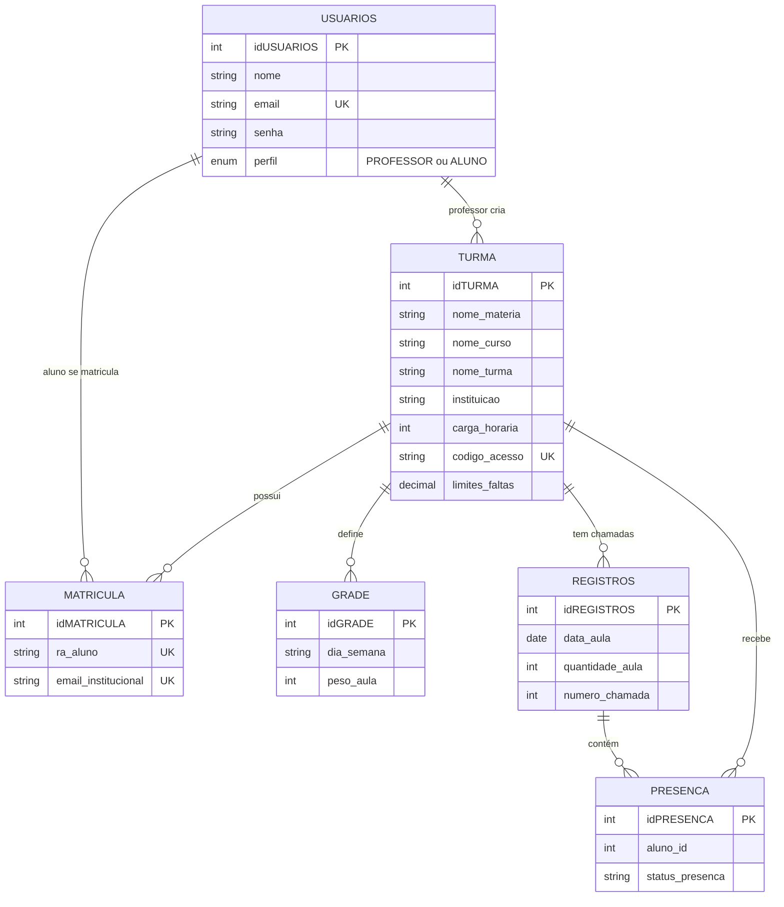
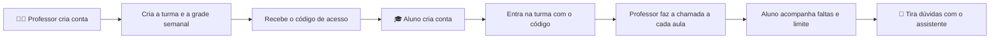

<div align="center">

# 📚 Presente! — Gerenciador de Faltas

**Sistema desktop para controle de presença e faltas em instituições de ensino**


</div>

---

## 📑 Sumário

- [Sobre o projeto](#-sobre-o-projeto)
- [Funcionalidades](#-funcionalidades)
- [Regras de cálculo](#-regras-de-cálculo)
- [Tecnologias](#-tecnologias)
- [Arquitetura](#-arquitetura)
- [Banco de dados](#-banco-de-dados)
- [Como executar](#-como-executar)
- [Fluxo de uso](#-fluxo-de-uso)
- [Equipe](#-equipe)

---

## 💡 Sobre o projeto

O **Presente!** nasceu para resolver um problema comum na vida acadêmica: o aluno nunca sabe ao certo quantas faltas já tem e quantas ainda pode ter, e o professor perde tempo controlando presença no papel.

O sistema conecta os dois lados:

- 👩‍🏫 O **professor** cria turmas, define a grade semanal e faz a chamada a cada aula.
- 🎓 O **aluno** entra na turma com um código, acompanha faltas e presenças por disciplina e conversa com um **assistente** que responde dúvidas sobre a própria situação acadêmica.

---

## ✨ Funcionalidades

### 🔐 Autenticação
- Criação de conta com escolha de perfil: **Aluno** ou **Professor**
- Login com redirecionamento automático para o painel do perfil

### 👩‍🏫 Painel do Professor
- Criação de turmas com instituição, curso, matéria, turma, período e carga horária
- Definição do **percentual máximo de faltas** de cada turma (padrão de 25%)
- Cadastro da **grade semanal**: dias da semana e quantidade de aulas em cada dia
- Geração de um **código de acesso** de 6 caracteres para os alunos entrarem na turma
- **Chamada** com registro de presença ou falta de cada aluno, por data e quantidade de aulas

### 🎓 Painel do Aluno
- Entrada em novas turmas usando o código fornecido pelo professor
- Visão geral de todas as disciplinas com faltas, presenças e aulas restantes
- **Histórico detalhado** de cada disciplina, chamada por chamada
- Indicador de quanto do limite de faltas já foi consumido

### 🤖 Assistente
- Chat integrado ao painel do aluno
- **Assistente local** (`Inteligente`): interpreta perguntas em português sobre faltas, situação nas matérias, grade semanal, aulas de amanhã e próxima aula, consultando o banco de dados
- **Integração com a API do Google Gemini** para perguntas gerais (opcional)

---

## 🧮 Regras de cálculo

Implementadas em `CalculoCargaHoraria`:

| Regra | Como funciona |
|---|---|
| Duração da aula | 1 aula = **50 minutos** |
| Total de aulas | carga horária em minutos ÷ 50, arredondado para cima |
| Limite de faltas | total de aulas × percentual permitido, arredondado para baixo |
| Semanas estimadas | total de aulas ÷ aulas por semana, arredondado para cima |

**Exemplo:** uma disciplina de 80 horas tem 96 aulas. Com limite de 25%, o aluno pode faltar até **24 aulas**.

---

## 🛠️ Tecnologias

| Tecnologia | Uso no projeto |
|---|---|
| **Java 21** | Linguagem principal |
| **Java Swing** | Interface gráfica desktop |
| **JDBC** | Comunicação com o banco |
| **MySQL 8** | Armazenamento dos dados |
| **MySQL Connector/J** | Driver JDBC |
| **Google Gemini API** | Respostas gerais do assistente (opcional) |
| **Eclipse IDE** | Desenvolvimento |

---

## 🏗️ Arquitetura

O projeto é organizado em camadas, cada uma em seu pacote:

```
src/
├── executavel/faltas/   → Main: ponto de entrada (abre a tela de login)
├── view/faltas/         → Telas Swing: Login, Cadastro, Painéis, Chamada, Histórico, Assistente
├── modelo/faltas/       → Entidades: Usuario, Aluno, Professor, Turma, Matricula, Grade, Registro, Presenca
├── dao/faltas/          → Acesso a dados: TurmaDAO, MatriculaDAO, AssistenteDAO
├── conexao/             → ConexaoMySQL: configuração da conexão
├── util/faltas/         → CalculoCargaHoraria: regras de cálculo
├── assistente/local/    → Inteligente: interpreta as perguntas do aluno
└── api/gemini/          → GeminiService: cliente HTTP da API Gemini
```

---

## 🗄️ Banco de dados

O script completo está em [`database/schema.sql`](database/schema.sql) (somente estrutura, sem dados).



| Tabela | Função |
|---|---|
| `usuarios` | Contas de alunos e professores |
| `turma` | Disciplinas criadas pelos professores |
| `matricula` | Vínculo do aluno com a turma (RA e e-mail institucional) |
| `grade` | Dias da semana e quantidade de aulas de cada turma |
| `registros` | Cada chamada realizada (data e quantidade de aulas) |
| `presença` | Status de cada aluno em cada chamada |

---

## 🚀 Como executar

### 1️⃣ Pré-requisitos
- ☕ JDK 21
- 🐬 MySQL Server em execução
- 📦 [MySQL Connector/J](https://dev.mysql.com/downloads/connector/j/) (arquivo `.jar`)
- 🧩 Eclipse IDE (recomendado)

### 2️⃣ Criar o banco de dados

```bash
mysql -u root -p < database/schema.sql
```

Ou, no MySQL Workbench: `File > Open SQL Script`, selecione o `schema.sql` e execute.

A conexão padrão do sistema é:

```
jdbc:mysql://localhost:3306/SISTEMADEFALTAS
usuário: root
```

### 3️⃣ Variáveis de ambiente

| Variável | Obrigatória | Descrição |
|---|:---:|---|
| `DB_SENHA` | ✅ | Senha do usuário `root` do MySQL |
| `GEMINI_API_KEY` | ❌ | Chave da API do Gemini (habilita respostas gerais no assistente) |
| `GEMINI_MODEL` | ❌ | Modelo do Gemini (padrão: `gemini-2.5-flash`) |

> ⚠️ A senha do banco **não fica no código**. Nunca envie senhas ou chaves de API para o repositório.

### 4️⃣ Rodar no Eclipse
1. `File > Import > Existing Projects into Workspace` e selecione a pasta do projeto.
2. Em `Build Path > Configure Build Path > Libraries`, ajuste o caminho do `mysql-connector-j.jar` para o da sua máquina.
3. Em `Run Configurations > Environment`, crie a variável `DB_SENHA`.
4. Execute a classe `executavel.faltas.Main`.

💡 Para testar só a conexão com o banco, execute `conexao.ConexaoMySQL`.

---

## 🔄 Fluxo de uso



---

## 👥 Equipe

| Integrante | GitHub |
|---|---|
| **Giovanna Carvalho dos Reis** | — |
| **Joao Carlos Nascimento de Menezes** | — |
| **Igor Diniz Lima** | [@igorlimza-tech](https://github.com/igorlimza-tech) |

---

<div align="center">

Feito com ☕ e muito código pela equipe do **Presente!**

</div>
